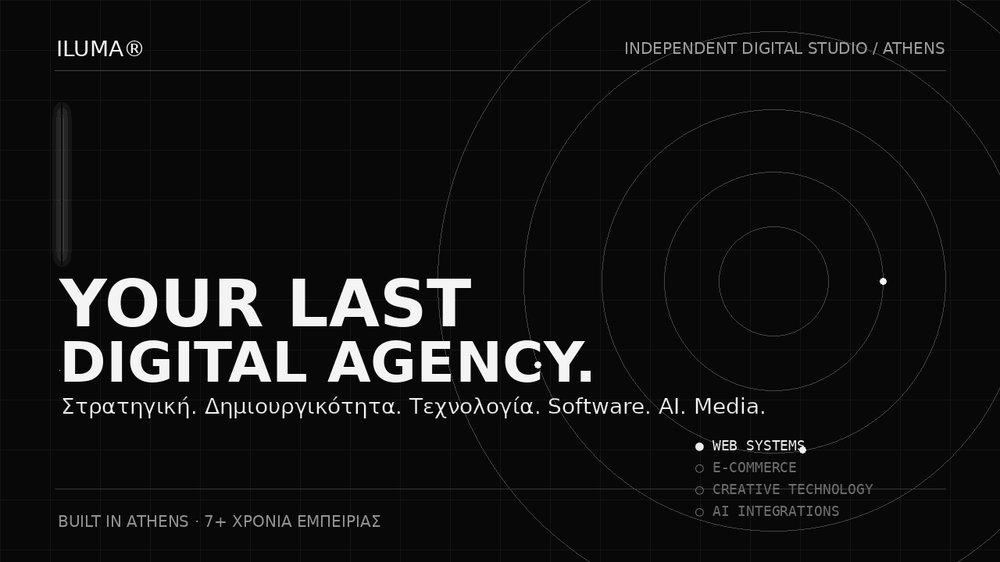
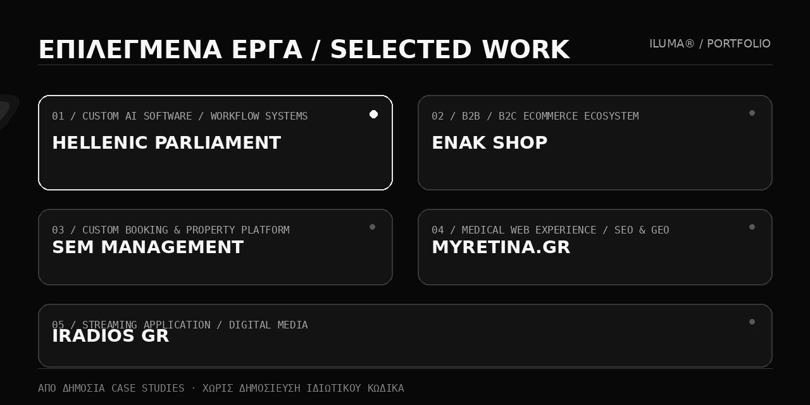

<!-- ILUMA Digital Agency | Public Organization Profile -->

  

  <a href="https://iluma.gr/">Website</a> &nbsp;·&nbsp;
  <a href="https://iluma.gr/agency">Η ILUMA</a> &nbsp;·&nbsp;
  <a href="https://iluma.gr/projects">Έργα</a> &nbsp;·&nbsp;
  <a href="https://iluma.gr/contact/">Επικοινωνία</a>

  
  

    <strong>Digital Agency × Creative Technology Studio</strong> 
    Αθήνα, Ελλάδα · 7+ χρόνια εμπειρίας · Strategy / Design / Software / AI / Media
  

---

## 01 / Η ILUMA

Η **ILUMA Digital Agency** είναι ένα ανεξάρτητο ψηφιακό studio με έδρα την Αθήνα. Συνδυάζουμε **στρατηγική, δημιουργικότητα, software engineering, performance marketing, AI integrations και digital media** για να σχεδιάζουμε εμπειρίες με πραγματικό επιχειρηματικό αποτέλεσμα.

Δεν αντιμετωπίζουμε το digital ως απλή παρουσία. Το αντιμετωπίζουμε ως **σύστημα**: brand, προϊόν, περιεχόμενο, αρχιτεκτονική, αυτοματισμοί και απόδοση πρέπει να λειτουργούν σαν ένα.

> **Your Last Digital Agency.**  
> Από τη στρατηγική και το design, μέχρι την ανάπτυξη, το launch και την εξέλιξη.

**[Γνωρίστε το studio μας ↗](https://iluma.gr/agency)**

---

## 02 / Τι κάνουμε

| Δημιουργικό & στρατηγική | Τεχνολογία & ανάπτυξη |
| :--- | :--- |
| **Brand Strategy & Identity** | **Web Development** |
| **UI/UX Design** | **Custom Web Applications** |
| **SEO & GEO** | **eCommerce Development** |
| **Performance Marketing** | **APIs & Systems Integrations** |
| **Content & Creative Production** | **AI & Automations** |
| **Audio & Digital Media** | **Infrastructure & Deployment** |

### Core stack

`React` · `Next.js` · `TypeScript` · `PHP` · `Laravel` · `WordPress` · `WooCommerce` · `Python` · `Docker` · `Linux` · `REST APIs` · `AI Integrations`

---

## 03 / Επιλεγμένα έργα

  

### [Hellenic Parliament AI Committee ↗](https://iluma.gr/projects/hellenic-parliament)
Custom εφαρμογή για τη διαχείριση και εποπτεία έργων Τεχνητής Νοημοσύνης της Βουλής των Ελλήνων, με έξυπνη αναζήτηση, workflows και αυτοματισμούς.

### [ENAK Shop ↗](https://iluma.gr/projects/enak-shop)
B2B και B2C eCommerce οικοσύστημα με έμφαση στη λειτουργικότητα, την ταχύτητα και την απρόσκοπτη εμπειρία αγοράς.

### [SEM Management ↗](https://iluma.gr/projects/sem-management)
Custom πλατφόρμα για property presentation, booking flows, live διαθεσιμότητα και λειτουργική διασύνδεση με εξωτερικά συστήματα.

### [myRetina.gr ↗](https://iluma.gr/projects/myretina)
Ιατρική και επιστημονική web εμπειρία με στοχευμένο UI/UX, σωστή πληροφοριακή αρχιτεκτονική και στρατηγική SEO/GEO.

### [iRadios GR ↗](https://iluma.gr/projects/iradios)
Streaming web application με έμφαση στην αμεσότητα, την καθαρή αλληλεπίδραση και τη συνολικά προσεγμένη media εμπειρία.

**[Περισσότερα case studies ↗](https://iluma.gr/projects)**

Τα παραπάνω links οδηγούν σε δημόσια case studies. Ο ιδιωτικός και εμπορικός πηγαίος κώδικας δεν δημοσιεύεται.

---

## 04 / Προϊόντα, εργαλεία & public presence

### [ILUMA OS ↗](https://github.com/ilumadigital/ILUMA_OS)
Δημόσιο repository για Ubuntu workstation setup και ILUMA-branded production environments.

### [ILUMA Radios ↗](https://iluma.gr/radios/)
Digital radio ecosystem με streaming εμπειρίες, σταθμούς, παραγωγή ήχου και media τεχνολογία.

### Open-source direction
Θέλουμε σταδιακά να δημοσιεύσουμε **components, utilities, starter kits και developer tools** που είναι πραγματικά χρήσιμα για τη δημόσια κοινότητα — πάντα χωρίς εσωτερικό ή πελατειακό κώδικα.

---

## 05 / Ας φτιάξουμε το επόμενο

  

Αν σχεδιάζετε ένα νέο brand, ένα eCommerce οικοσύστημα, μια custom εφαρμογή ή την επόμενη μεγάλη ψηφιακή σας κίνηση, είμαστε έτοιμοι να τη σχεδιάσουμε και να τη χτίσουμε μαζί σας.

  <a href="https://iluma.gr/contact/"><strong>Στείλτε μας το project brief σας ↗</strong></a> &nbsp;·&nbsp;
  <a href="mailto:hello@iluma.gr">hello@iluma.gr</a> &nbsp;·&nbsp;
  <a href="https://iluma.gr/">iluma.gr</a>

© 2026 ILUMA Digital Agency · Αθήνα, Ελλάδα · Your Last Digital Agency.

