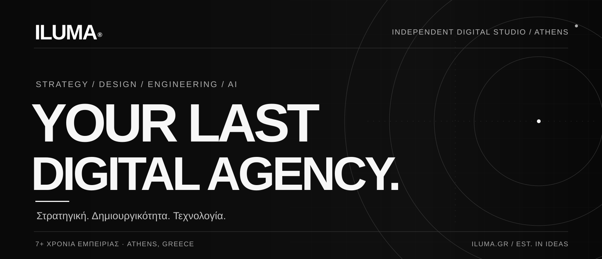
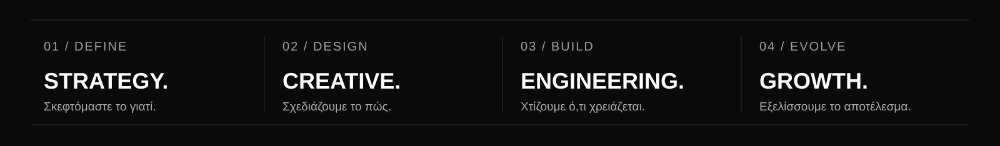
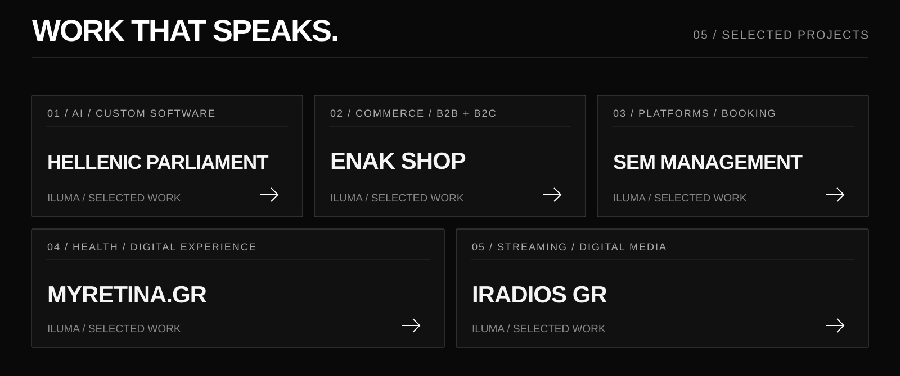
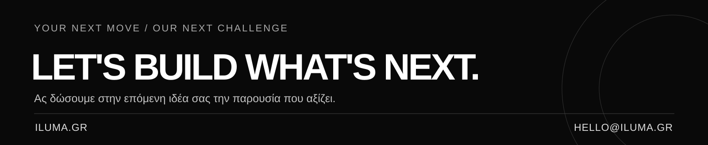

<!-- ILUMA DIGITAL AGENCY | OFFICIAL ORGANIZATION PROFILE -->

  

  <a href="https://iluma.gr/"><strong>WEBSITE</strong></a>&nbsp; · &nbsp;
  <a href="https://iluma.gr/agency">Η ILUMA</a>&nbsp; · &nbsp;
  <a href="https://iluma.gr/projects">ΤΑ ΕΡΓΑ ΜΑΣ</a>&nbsp; · &nbsp;
  <a href="https://iluma.gr/contact/">ΕΠΙΚΟΙΝΩΝΙΑ</a>

  

## 01 — Η ILUMA

Είμαστε ένα ανεξάρτητο **Digital Agency & Creative Technology Studio** με έδρα την Αθήνα. Συνδυάζουμε στρατηγική, σχεδιασμό, software engineering, τεχνητή νοημοσύνη, performance marketing και digital media για να δημιουργούμε ολοκληρωμένες ψηφιακές εμπειρίες.

Για εμάς, ένα brand δεν είναι απλώς μια εικόνα. Είναι το άθροισμα της εμπειρίας, της τεχνολογίας και της σχέσης με το κοινό του. Γι' αυτό σχεδιάζουμε και κατασκευάζουμε λύσεις που **λειτουργούν ως ενιαίο ψηφιακό οικοσύστημα**.

**Your Last Digital Agency.** Από την πρώτη ιδέα μέχρι την υλοποίηση και την επόμενη μέρα.

[Ανακαλύψτε την ILUMA και τη φιλοσοφία μας ↗](https://iluma.gr/agency)

---

## 02 — Τι δημιουργούμε

| CREATIVE & GROWTH | TECHNOLOGY & ENGINEERING |
| :--- | :--- |
| Branding & Brand Strategy | Custom Web Development |
| UI/UX Design | Web Applications & Platforms |
| SEO, GEO & AI Visibility | eCommerce / B2B & B2C |
| Performance Advertising | APIs & System Integrations |
| Content & Creative Production | AI Integrations & Automations |
| Digital & Audio Media | Infrastructure & Deployment |

**Το technology stack μας**

`React` · `Next.js` · `TypeScript` · `PHP` · `Laravel` · `Python` · `WordPress` · `WooCommerce` · `Docker` · `Linux` · `APIs` · `AI Integrations`

---

## 03 — Επιλεγμένα έργα

  

| PROJECT | Η ΠΡΟΚΛΗΣΗ |
| :--- | :--- |
| **[Hellenic Parliament ↗](https://iluma.gr/projects/hellenic-parliament)** | Εξειδικευμένες εφαρμογές και λύσεις AI για θεσμικά workflows. |
| **[ENAK Shop ↗](https://iluma.gr/projects/enak-shop)** | Σύγχρονο ηλεκτρονικό εμπόριο και εμπειρίες B2B/B2C. |
| **[SEM Management ↗](https://iluma.gr/projects/sem-management)** | Custom ψηφιακή πλατφόρμα με συστήματα κρατήσεων και διασυνδέσεις. |
| **[myRetina.gr ↗](https://iluma.gr/projects/myretina)** | Ιατρική web παρουσία με προσεγμένο UX και στρατηγική περιεχομένου. |
| **[iRadios GR ↗](https://iluma.gr/projects/iradios)** | Streaming εφαρμογή και ολοκληρωμένη ψηφιακή εμπειρία audio. |

[Δείτε όλα τα δημόσια case studies ↗](https://iluma.gr/projects)

Τα case studies είναι δημόσια. Ο πηγαίος κώδικας ιδιωτικών εφαρμογών και πελατειακών έργων παραμένει ιδιωτικός.

---

## 04 — Τα δικά μας προϊόντα

**[ILUMA OS ↗](https://github.com/ilumadigital/ILUMA_OS)** — Δημόσιο repository με εργαλεία παραμετροποίησης και setup Ubuntu workstations.

**[ILUMA Radios ↗](https://iluma.gr/radios/)** — Οικοσύστημα audio, streaming και ψηφιακών ραδιοφωνικών εμπειριών.

**Open source, επιλεκτικά.** Εξετάζουμε τη δημόσια διάθεση components, starter kits και developer tools, με διαχωρισμό από τον ιδιωτικό και πελατειακό μας κώδικα.

---

## 05 — Η επόμενη ιδέα

  

  <a href="https://iluma.gr/contact/"><strong>ΣΥΖΗΤΗΣΤΕ ΜΑΖΙ ΜΑΣ ΤΟ PROJECT ΣΑΣ ↗</strong></a>
  &nbsp; · &nbsp; <a href="mailto:hello@iluma.gr">hello@iluma.gr</a>
  &nbsp; · &nbsp; <a href="https://iluma.gr/">iluma.gr</a>

© 2026 ILUMA Digital Agency &nbsp; · &nbsp; Athens, Greece &nbsp; · &nbsp; Your Last Digital Agency.

