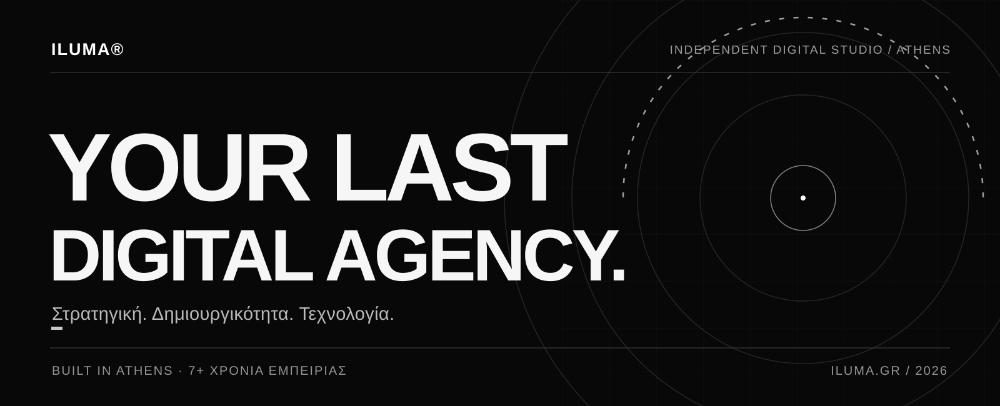
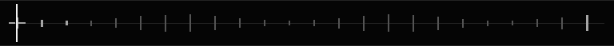
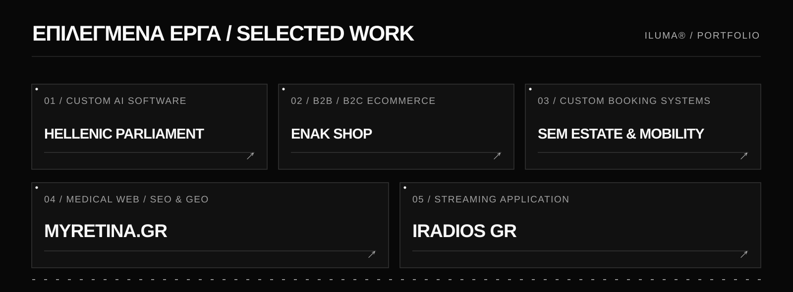
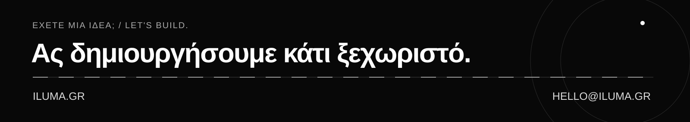

<!-- ILUMA Digital Agency | Public Organization Profile
Only links to already-public projects. No private source code or internal details. -->

  
  

  <a href="https://iluma.gr/">Website</a> &nbsp;·&nbsp;
  <a href="https://iluma.gr/agency">Η ILUMA</a> &nbsp;·&nbsp;
  <a href="https://iluma.gr/projects">Έργα</a> &nbsp;·&nbsp;
  <a href="https://iluma.gr/contact/">Επικοινωνία</a>

  <picture>
  <source media="(prefers-color-scheme: dark)" srcset="https://iluma.gr/assets/images/iluma%20digital%20agency.png" />
  
  </picture>
  
<strong>Digital Agency × Creative Technology Studio</strong> 
  Αθήνα, Ελλάδα · 7+ χρόνια εμπειρίας

---

### 01 / Ποιοι είμαστε

Η **ILUMA Digital Agency** είναι ένα ανεξάρτητο ψηφιακό studio με έδρα την Αθήνα. Ενώνουμε **στρατηγική, σχεδιασμό, τεχνολογία, performance marketing, τεχνητή νοημοσύνη και media** σε μία ομάδα.

Σχεδιάζουμε και αναπτύσσουμε ψηφιακά προϊόντα, εφαρμογές, ηλεκτρονικά καταστήματα και καμπάνιες με ουσιαστικό επιχειρηματικό στόχο. Δεν μας αρκεί μια εντυπωσιακή εικόνα: μας ενδιαφέρει η ταχύτητα, η προσβασιμότητα, η καθαρή αρχιτεκτονική και η πραγματική εμπειρία του χρήστη.

> **Your Last Digital Agency.** — Μία συνεργασία, από τη στρατηγική έως την υλοποίηση.

**[Γνωρίστε το studio μας ↗](https://iluma.gr/agency)**

---

### 02 / Τι κάνουμε

| Στρατηγική & δημιουργικό | Τεχνολογία & ανάπτυξη |
| :--- | :--- |
| **Brand Strategy & Identity** — ταυτότητες με ξεκάθαρη κατεύθυνση. | **Web Development** — custom ιστοσελίδες και web εφαρμογές. |
| **UI/UX Design** — λειτουργικές, προσεγμένες ψηφιακές εμπειρίες. | **eCommerce Development** — λύσεις B2B και B2C. |
| **SEO & GEO** — οργανική και AI-oriented ορατότητα. | **Software Engineering** — πλατφόρμες, APIs και ολοκληρώσεις. |
| **Performance Marketing** — στρατηγική, διαφημίσεις και βελτιστοποίηση. | **AI & Automations** — έξυπνες ροές και ενσωματώσεις. |
| **Content & Creative Production** — περιεχόμενο με ουσία. | **Audio & Digital Media** — streaming και radio ecosystems. |

---

### 03 / Επιλεγμένα έργα

  

#### [Hellenic Parliament AI Committee ↗](https://iluma.gr/projects/hellenic-parliament)
Εξειδικευμένη custom εφαρμογή για την εποπτεία και τη διαχείριση έργων Τεχνητής Νοημοσύνης της Βουλής των Ελλήνων, με λειτουργίες έξυπνης αναζήτησης και αυτοματισμούς.  
`Custom Software` · `AI Integrations` · `PHP`

#### [ENAK Shop ↗](https://iluma.gr/projects/enak-shop)
Οικοσύστημα ηλεκτρονικού εμπορίου B2B και B2C με προτεραιότητα στην ταχύτητα, τη λειτουργικότητα και την απρόσκοπτη εμπειρία αγοράς.  
`eCommerce` · `Custom Development` · `Performance`

#### [SEM Estate & Mobility ↗](https://iluma.gr/projects/sem-management)
Premium πλατφόρμα παρουσίασης ακινήτων με custom booking engine, live διαθεσιμότητα και διασύνδεση με συστήματα διαχείρισης ακινήτων.  
`Web Applications` · `Booking Systems` · `API Integrations`

#### [myRetina.gr ↗](https://iluma.gr/projects/myretina)
Ιατρική και επιστημονική διαδικτυακή πύλη με εξατομικευμένο UI/UX, αρχιτεκτονική περιεχομένου και στρατηγική SEO/GEO.  
`Medical Web` · `UI/UX` · `SEO & GEO`

#### [iRadios GR ↗](https://iluma.gr/projects/iradios)
Custom streaming web εφαρμογή με έμφαση στην άμεση ακρόαση, στην ομαλή αλληλεπίδραση και σε μία προσεγμένη εμπειρία χρήσης.  
`Streaming` · `Software Engineering` · `Digital Media`

**[Δείτε περισσότερα έργα & case studies ↗](https://iluma.gr/projects)**

Τα links παραπέμπουν σε δημόσια case studies. Ο πηγαίος κώδικας των ιδιωτικών και εμπορικών έργων δεν δημοσιεύεται.

---

### 04 / Technology stack

Συνδυάζουμε ώριμες τεχνολογίες με σύγχρονες πρακτικές ανάπτυξης, επιλέγοντας κάθε φορά την κατάλληλη αρχιτεκτονική για το πρόβλημα που λύνουμε.

| Πεδίο | Τεχνολογίες |
| :--- | :--- |
| **Frontend** | `React` · `Next.js` · `TypeScript` |
| **Backend** | `PHP` · `Laravel` · `Python` |
| **CMS & eCommerce** | `WordPress` · `WooCommerce` |
| **Infrastructure** | `Docker` · `Linux` |
| **Integrations** | `REST APIs` · `AI Integrations` · `Automation` |

**Στόχος μας:** καθαρός, συντηρήσιμος κώδικας και ψηφιακά προϊόντα που μπορούν να εξελίσσονται.

---

### 05 / Τα δικά μας προϊόντα & εργαλεία

**[ILUMA OS ↗](https://github.com/ilumadigital/ILUMA_OS)**  
Δημόσιο repository με εργαλεία εγκατάστασης και παραμετροποίησης Ubuntu workstations για την ομάδα της ILUMA.

**[ILUMA Radios ↗](https://iluma.gr/radios/)**  
Το δικό μας οικοσύστημα digital radio, με τους σταθμούς Deseo Radio και Epic Radio, audio παραγωγή και εμπειρίες streaming.

**Εσωτερικές πλατφόρμες & αυτοματισμοί**  
Αναπτύσσουμε συστήματα που υποστηρίζουν την καθημερινή λειτουργία και την παραγωγή μας. Παραμένουν ιδιωτικά εκτός αν αποφασίσουμε ρητά τη δημοσίευσή τους.

**Open source προοπτική.** Μας ενδιαφέρει η δημιουργία χρήσιμων components, developer tools και starter kits. Θα δημοσιεύονται μόνο έτοιμα για δημόσια χρήση έργα, χωρίς εσωτερικό ή πελατειακό κώδικα.

---

### 06 / Ας φτιάξουμε το επόμενο

  

Ένα νέο brand, ένα eCommerce οικοσύστημα, μια εξειδικευμένη εφαρμογή ή η επόμενη ψηφιακή σας κίνηση; **Ας συζητήσουμε την ιδέα σας.**

  <a href="https://iluma.gr/contact/"><strong>Στείλτε ένα project brief ↗</strong></a> &nbsp;·&nbsp;
  <a href="mailto:hello@iluma.gr">hello@iluma.gr</a> &nbsp;·&nbsp;
  <a href="https://iluma.gr/">iluma.gr</a>

© 2026 ILUMA Digital Agency · Αθήνα, Ελλάδα · Your Last Digital Agency.

